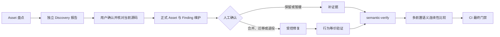
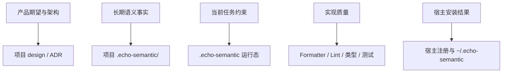

# 核心概念

`echo-semantic 0.5.0` 将“需要模型判断的语义工作”与“可以机器确定的结构和 Git 事实”分开。理解这条边界，是正确使用插件的前提。

## 四层约束

老项目整合路径在这四层之内按以下顺序收敛：

| 层     | 能解决什么                                   | 不能证明什么                 |
| ------ | -------------------------------------------- | ---------------------------- |
| Skill  | 复用分析、边界识别、产品预期、风险假设       | 每次都被加载、工具一定被阻断 |
| Hook   | 会话注入、编辑范围检查、压缩恢复、停止前校验 | 所有宿主和配置中一定触发     |
| 校验器 | 对象结构、快照、引用、路径分类、变更依据     | 业务正确、审查充分、没有缺陷 |
| CI     | 在独立环境重跑最终门禁                       | 替代项目自己的工程测试       |

## 语义对象

| 对象           | 用途             | 典型内容                                               |
| -------------- | ---------------- | ------------------------------------------------------ |
| Baseline       | 仓库级入口       | 源码快照、路径区域、边界、覆盖网格和闭合状态           |
| Capability Map | 能力导航         | 场景、入口、输出、状态流、策略和相关对象               |
| Behavior       | 重要行为承诺     | 当前行为、期望行为、失败恢复和证据                     |
| Rule           | 不变量或唯一权威 | 状态权威、优先级、不可同时成立的约束                   |
| Evidence       | 可复用事实证据   | 源码、测试、契约和运行证据及其限制                     |
| Finding        | 可处置问题       | 触发条件、影响、修复和验证证据                         |
| Audit          | 定向审查记录     | 指定 revision、边界、风险视角和故障假设                |
| Discovery      | 发现过程证据     | 扫描范围、候选事实、归并结果和未知项                   |
| Asset          | 语义资产清单     | 文件、符号、入口、状态权威、协议、测试消费者和文档身份 |

对象使用带 YAML 前置元数据的 Markdown。完整字段见 [语义材料合同](../skills/semantic-contract/references/semantic-artifact-contract.md)。

## 八个风险视角

每个中高风险边界都应考虑以下视角：

| 风险视角              | 关注问题                                       |
| --------------------- | ---------------------------------------------- |
| `trigger_input`       | 谁触发、输入从哪里进入、如何校验               |
| `result_side_effect`  | 产生哪些返回值、写入和外部副作用               |
| `state_authority`     | 哪个组件拥有最终状态，是否存在双写或平行真理源 |
| `data_durability`     | 数据写到哪里，何时持久化、清理或迁移           |
| `time_lifecycle`      | 启动、恢复、超时、停止和跨会话行为             |
| `failure_concurrency` | 失败、重试、取消、并发和恢复是否闭合           |
| `permission_external` | 权限、敏感信息和外部系统交互                   |
| `contract_evidence`   | 公共契约、测试和证据能证明什么                 |

## 闭合状态

Baseline 有两个独立闭合字段：

- `inventory_closure`：Git 路径、边界和风险视角是否都有明确去向；
- `behavior_model_closure`：重要能力场景、行为、规则和证据是否充分展开。

`closed` 不表示“安全”或“没有缺陷”。新路径未分类、引用失效或证据过期时，校验器仍会失败。

## 六类路由

| 路由          | 含义                               | 典型变化                                   |
| ------------- | ---------------------------------- | ------------------------------------------ |
| `bootstrap`   | 基线、宿主能力或 Hook 事件证据不足 | 明确任务的宿主未探测到或 Stop 尚未真实触发  |
| `idle`        | 当前没有工作树变化                 | 明确任务开始前                             |
| `maintenance` | 用户显式要求 repository 范围       | 显式全项目治理   |
| `fast`        | 低风险快速路径                     | 文档、配置、测试、示例                     |
| `standard`    | 一般差异，需要影响分析             | 非生产源码且不全是快速路径                 |
| `strict`      | 高风险边界，需要同次证据和定向审查 | 生产源码、未知源码、协议、迁移、治理控制面 |

路由是根据当前事实重新计算的短期结果，不是项目任务状态机。用户显式指定 repository 范围时使用 `maintenance`，建议执行全仓
`semantic-discover`、`semantic-status`、`semantic-consolidate`、`semantic-audit` 和 `semantic-verify`；日常任务只调查允许路径及其相关消费者。无明确任务时等待。
差异出现后风险可以升级，不能因为生成前判断为低风险而强制降级。

## 会话与任务短期状态

| 状态             | 位置                                   | 约束                                                                 |
| ---------------- | -------------------------------------- | -------------------------------------------------------------------- |
| Preflight        | `.echo-semantic/preflight.json`        | 绑定仓库、HEAD、任务，最长 24 小时                                   |
| Route            | `.echo-semantic/route.json`            | 绑定宿主探测、Hook 事件证据、HEAD 和工作树摘要，最长 24 小时         |
| Continuation     | `.echo-semantic/continuation.json`     | 绑定任务、分支和证据摘要，最长 7 天                                  |
| Session snapshot | `.echo-semantic/session-snapshot.json` | 按会话绑定仓库、HEAD 和组合工作树指纹，最长 7 天、最近 128 个会话    |
| Stop dedupe      | `.echo-semantic/stop-dedupe.json`      | 按会话绑定失败原因、组合工作树和结算证据，最长 24 小时、最近 128 个会话 |

这些文件不提交 Git，不定义项目架构。它们损坏或失效时，系统回到重新预检、重新路由或无恢复提示状态。

原始验证输出和临时工作文件统一保存在 `.echo-semantic/local/<task-id>/`，整体本地忽略；它不是语义对象目录，也不进入源码摘要或分发。长期 Evidence 只提炼必要结论及原件引用；原件过期或仅本地可用需要说明，哈希不能代替实际执行证据。正式测试与必要 fixture 按项目规则进入 Git。

会话首次发现已有差异时，助手会先盘点并询问处置策略，不把未提交直接称为缺陷。用户未答复前只允许只读，暂停修改与交付；只读结束保留“待裁决、未验证”，不重复触发 Stop。用户可接管指定差异、保留已有差异仅处理本轮范围，或暂停修改仅只读；策略保存在同一会话快照，不表示验证通过，也不授权提交或清理。保留/未接管路径继续受保护，HEAD 或保护内容变化后重新询问；resume/compact 不丢失已有裁决。

处置提问必须先展示可核对的事实，而不是只说“存在差异”：包括仓库根、状态计数、路径与暂存状态；嵌套仓库还包括父仓索引 revision、当前 HEAD、分支和内部差异摘要。助手把这些事实与当前任务 Git 根、worktree 及允许路径比较后，给出一个带理由的推荐；无法可靠判断时推荐只读。该推荐不代替用户裁决，也不读取或展示完整差异内容。

确定性写入检查仅覆盖真实宿主可观察到的 Hook；其它写入入口依赖 semantic-preflight 的助手流程，不能将该提示词称为全面机器门禁。任务预检、继续包和可见状态仍是项目级当前任务状态。

组合工作树指纹包含 HEAD、原始 porcelain、索引 blob 元数据和已有差异路径的内容摘要，不扫描无差异文件。Route 保存当前指纹和成功 Stop 的 `verificationReceipt`；会话快照与失败去重记录在 repo-local 短期锁下串行更新，避免并发会话互相覆盖。成功收据和失败去重都只用于绑定条件完全一致的宿主重入，不能替代新的语义验证。

编辑准入使用 `observation: edit`，只取得当前 HEAD 与路径状态，`worktreeFingerprint: null` 不代表无变化或验证通过。受保护的已有差异仍单独核对内容；完整指纹在会话开始、停止、压缩及手动观察时计算。仅编辑准入可复用身份未变且五分钟内的成功宿主探测，停止强制重新探测；缓存不是现场加载证据。引用元数据只在本次检查内复用，下次重新读取。见 [性能优化设计](designs/preflight-performance.md)。

快照、去重、路由、预检与 Stop 结算读取拒绝 symlink 和超过 1 MiB 的内容；继续包原有读取路径不包含在这项边界改造中。陈旧锁只有在独立 recovery guard 下确认可信持有 PID 已退出后才回收；活或未知持有者只会触发有界超时，不按锁年龄删除。

脏 submodule 的 nested Git 在 POSIX 上通过已验证目录 fd 和现有 `python3` 标准库 `fchdir` 入口执行；目录 fd 或 `fchdir` 能力不可用时，指纹返回不可用且不会改用可变路径。干净 submodule 不需要该递归入口。

## 单一权威

同一个事实不能同时由两套材料拥有：

- 设计与 ADR 决定“应该怎样”；
- 源码与机器契约说明“现在怎样”；
- `.echo-semantic/` 连接行为、规则与证据；
- 工程工具决定代码是否满足格式、类型和测试要求；
- 预检和继续包只约束当前任务。

## Finding、Audit 与裁决

Audit 必须绑定“边界 × 风险视角 × revision”，并提出可被反证的故障假设。Finding 只有具备修复、验证和复审证据时才能
标记为 `resolved`；接受残余风险必须引用人的明确裁决。

`semantic-decide` 只处理证据无法替代的问题，例如兼容性取舍、产品预期冲突和风险接受。普通技术问题应继续调查，不要过早交给人裁决。

任务预检使用 schemaVersion: 2，复用依据由 searchPaths、decision、reason、candidates、evidence 表达。验证收据单独使用 schemaVersion: 2，并绑定 task 范围、任务身份、相关内容和验证路径；旧收据不能用于新范围的重复完成豁免。`task:<digest>` 表示明确局部范围的源码签名，不表示全项目 source 快照。

Discovery 的 scan_report 内嵌静态资产和待确认候选，与正式 Asset/Finding 分开。报告摘要绑定文件身份清单与实际排除项，不能直接当作 Baseline 的严格源码摘要。结构检查、当前源码核对、人的语义确认与全项目闭合是四个不同结论。

用户配置的外部调度调用同一扫描入口。配置示例与验收步骤见[用户定时扫描](scheduled-scanning.md)，实际周期、目标和权限都不由插件写死。
