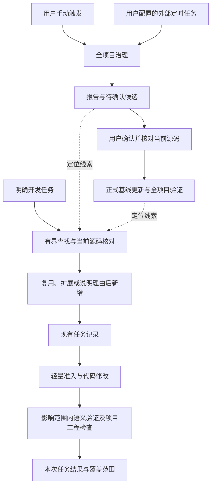

# 任务范围内的复用治理与轻量验证

## 确认依据与设计状态

本设计依据 2026-10-12 当前对话中用户确认的方案：精简现有插件，每个开发任务记录一次复用检查，保留轻量机器检查；保留全项目治理，支持手动或定时触发；定时扫描生成报告与候选，确认后再更新正式语义基线。

本文描述目标状态，尚不表示相关行为已实现、已安装或经过真实宿主验收。设计入口采用本次对话已确认的路径 `docs/designs/task-scoped-reuse-governance.md`。

调查依据为主 checkout `main@8ecb51f9119a96ac9fa09ffc500f1a3dea299fdb` 及当前磁盘上的已有未提交改动。仅新增本文，已有差异保留；实现时须重新核对源码与工作区，不能把该提交标识当作全部磁盘内容的版本。

## 问题与目标

Agent 实现功能或修复缺陷时容易新增近似逻辑，已有能力缺少稳定的查找与复用过程。与此同时，普通开发任务可能被引入全项目发现、建模、审计和严格快照校验，治理成本超过任务本身。

目标是让日常任务能够回答四个问题：已有能力在哪里，为什么复用或不复用，修改影响哪些消费者，怎样验证本次行为。全项目治理独立发现跨模块重复、平行状态权威和覆盖缺口，为后续任务提供定位线索。

轻量化同时约束 Agent 的调查范围和确定性工具的执行范围，不能只缩短提示词或减少报告篇幅。局部完成与全项目闭合分别表达。

## 当前事实与既有设计关系

- `skills/semantic-preflight/SKILL.md` 已要求从目标实现、直接调用方、已有 Capability Map 和相关测试开展有界调查，并为同一任务复用记录。
- `runtime/route.mjs` 在不存在基线时建议建库；没有差异且无法绑定当前任务时建议仓库维护。`hooks/entry.mjs` 的会话提示会据此引导全项目发现、归并、审计和验证。没有代码差异不能证明用户没有开发任务。
- Stop 当前调用 `--strict-snapshot --require-change-evidence`；`skills/semantic-contract/scripts/verify_semantic.py` 的严格摘要会遍历纳入检查的 Git 路径并读取文件内容。
- 现有预检合同只要求 `reuse` 为非空字符串列表，无法表达候选引用是否有效，也不能证明实际搜索充分。
- 已有 `inventory.py` 支持全仓或 `--path` 盘点，`consolidate.py` 支持归并候选；静态相似只形成候选，不能证明行为等价。

本文在 `docs/designs/preflight-performance.md` 的有界调查、任务记录复用、编辑轻量观察及已有差异保护基础上，进一步改变普通任务的自动路由和最终语义验证范围。原设计保留全项目 Stop 校验的要求，不能继续作为本设计日常完成检查的依据；工作区保护、记录新鲜度、风险只能升级和项目强制工程检查等约束继续适用。

## 范围与非目标

覆盖开发前复用检查、任务内增量检查、相关语义影响分析、编辑准入、任务完成验证，以及手动或定时全项目治理的触发和结果边界。

不自动重构、合并或删除业务代码，不新增数据库、常驻服务、隐藏遥测或项目专属策略，不创建第二套语义事实库、任务状态机或候选数据库。本文不定义新的状态 schema、宿主 Hook 事件、定时周期或具体部署平台。

项目原有 formatter、Lint、类型检查、测试及交付要求继续生效。本文不授权提交、安装、发布、设置实际定时任务或扩大已有差异接管范围。

## 目标行为

### 日常任务入口与查找

明确开发任务进入任务范围内的复用检查。没有明确任务时等待用户指令，不能仅凭干净工作树进入维护；已有基线不自动启动全项目治理，缺少基线也不强制先建库。

优先读取目标模块、已有能力描述、相关接口和测试。通过名称、业务概念、输入输出、协议字段及真实调用线索检索相同或相似能力。必要时允许仓库范围的定向检索，但只深入阅读候选及其相关消费者，不把逐文件建模作为默认前置条件。

已有地图、历史扫描报告和候选用于定位，当前源码与消费者用于判断。找到足以回答复用、语义归属、影响范围和验证方式的证据后停止调查。

证据不足时围绕一个具体未知问题扩大范围。公共接口、共享状态、持久化、权限、并发恢复和外部副作用扩大到相关边界及消费者；不能因风险升级自动调用全项目扫描。动态调用等无法确认的影响保持未知，不能解释为无影响。

### 复用决定

复用顺序为直接使用已有实现、扩展已有实现、说明不适用理由后新增。判断比较行为及边界，包括输入输出、状态归属、权限、副作用和失败处理，不能仅凭文本、名称或代码行数相似合并。

候选只部分匹配时，评估扩展对已有消费者的影响；不得为减少少量表面重复强行提取不稳定抽象。无法复用或未找到合适候选时记录原因及实际搜索范围，不宣称仓库不存在任何相似逻辑。

### 任务记录与增量检查

沿用现有任务预检记录和写入合同。一个任务首次建立一次记录，内容应可审阅地表达搜索范围、候选路径或符号、复用决定、未采用理由、允许修改范围和验证方式；无候选时记录搜索依据。具体字段兼容与机器合同由后续 Plan 明确，本文不另建存储或 schema。

记录继续绑定仓库、任务和源码依据。相邻编辑、后续对话及修复同一测试失败复用该记录；目标、授权、范围、相关内容或风险变化时只补查受影响部分并更新。新任务不能继承旧任务授权，同一任务风险不能降低，检查不自动延长记录有效期。

Hook 检查记录存在性与有效性、可确定核对的候选引用、相关依据、实际修改范围及既有高风险约束。缺记录、过期、越界或相关依据失效时拒绝对应写入并指出需补充的任务依据；拒绝不触发全项目扫描。

机器检查不证明语义判断正确、搜索完整或没有重复实现。候选行为是否适用由 Agent 调查和审查承担，业务正确性由相关工程验证支持。

### 日常任务完成

从实际差异确定直接受影响对象，并沿消费者、共享状态权威、生命周期和契约扩展到必要的影响范围。调查范围不能只等于允许写入路径；发现缺口应补充任务范围和依据。

完成检查核对本次差异、相关语义引用与依据、适用的变更约束和验证结果。普通任务无需全项目建库、全项目语义闭合或全项目源码摘要计算；全局基线漂移不能单独迫使该任务转入全量治理，相关引用失效则必须处理。

未采用基线的任务仍检查复用记录、变更范围和适用的风险依据；已有基线时维护受影响语义事实，不以局部更新宣称整体快照已刷新。

项目要求的完整工程命令按原有规则执行，其范围与插件语义检查范围分别报告。若采用方主动配置全项目检查为交付要求，执行该明确要求；插件不把它设为每次普通任务的默认动作。

Git 状态盘点和既有受保护差异的内容核对继续用于授权与工作区保护，不等于开展全项目语义扫描。轻量化不能削弱既有差异保护、删除授权、锁内校验或验证收据失效规则。

### 全项目治理

保留全项目发现、资产盘点、候选归并、定向审计和严格快照检查，接受用户手动调用或用户配置的定时任务调用。两个入口复用同一治理能力，周期、目标仓库和执行环境由用户配置。

调度由宿主自动任务或 CI 等外部执行环境承担，插件提供可调用的扫描能力。不能把 SessionStart、Stop 或“没有差异”作为替代定时器，不新增常驻进程。宿主具体接线必须依据官方能力或真实加载证据验收。

全项目扫描绑定可识别且一致的源码快照，记录覆盖范围、重复候选、风险、未知项和证据限制。静态盘点与需要 Agent 判断的语义调查分开报告；只运行静态工具不能声称已完成行为治理。

扫描可以保存报告和待确认候选，不能自动改写正式 Baseline、Capability Map、Behavior、Rule 或把候选实现确立为唯一 owner。手动扫描触发本身也不表示批准基线变更或业务修复。

报告与候选保存在采用方 `.echo-semantic/`，优先复用 Discovery、Asset 和 Finding 的现有表达；候选与已确认语义事实应明确区分。长期报告与候选按仓库规则版本管理，只有明确运行态文件排除提交。后续 Plan 须核对现有合同如何容纳无正式基线的扫描报告，不能自动建库以绕过该边界。

用户确认候选及语义事实后，核对当前源码与扫描依据，再更新正式基线并执行相应全项目验证。业务修复、删除、提交和发布各自遵守已有授权边界。

## 系统边界与数据流

`skills/` 继续是工作流唯一真理源，`agents/` 继续是只读角色唯一真理源；宿主清单只负责发现与映射。现有运行态模块管理任务记录、锁与有效性；Hook 和校验器承担确定性检查。

长期语义事实只由已确认的项目语义材料表达。任务记录不是架构库，扫描报告不是正式基线，路由和状态展示不能成为新的授权或语义权威。

任务完成结果只能证明所列任务范围；扫描结果只能证明所列快照与已完成检查。全项目库存闭合、行为模型闭合和严格快照一致性仍分别报告。

## 异常与边界场景

| 场景 | 目标行为 |
| --- | --- |
| 没有基线的小功能开发 | 从源码找候选，建立任务记录并完成相关验证，不启动建库 |
| 干净工作树中开始新任务 | 进入任务检查；没有任务时等待，不自动维护 |
| 找到同名但语义不同的实现 | 记录差异，不强行复用；新增必须有具体理由 |
| 候选不在目标模块 | 读取候选及相关消费者，必要时扩大任务范围 |
| 同一任务多次编辑或测试修复 | 复用记录，只核对与变化有关的事实 |
| 修改范围、HEAD 或相关依据变化 | 更新或重建失效部分；不能借新记录降低风险 |
| 存在未经接管的已有差异 | 继续保护；完成结果不包含未授权接管或未验证内容 |
| 基线整体过期、相关候选仍可核对 | 核对当前相关源码；分别表达局部结果与全局过期状态 |
| 动态入口或消费者影响无法确认 | 保留未知和证据缺口，扩大相关调查，不伪造完成 |
| 定时扫描遇到正在修改的工作树 | 使用可证明一致的扫描快照；无法取得时报告未完成，不覆盖开发任务记录 |
| 手动扫描与定时扫描同时发生 | 复用现有协调能力避免候选覆盖和快照混用；无法协调时明确失败 |
| 扫描超时、执行环境缺能力或仅完成静态盘点 | 保存实际覆盖与未完成项，不产生全项目通过结论 |
| 扫描后源码变化才确认候选 | 重新核对相关源码，原报告不直接成为当前基线 |
| 用户确认语义基线但未授权业务修复 | 仅在所确认范围维护语义材料，业务修改仍需独立任务 |

后台扫描不能消费或改写日常任务的预检、继续包或验证收据。失败报告不能取代先前有效事实，也不能把部分扫描标为成功。

## 关键取舍

选择每任务一次的简短记录与确定性检查，使复用决定可审阅并能拒绝缺少依据的写入。仅使用 Skill 引导的方案被排除，因为用户明确选择保留机器检查；记录不因此扩张为每任务完整架构报告。

选择保留独立全项目治理，承担跨模块发现和整体覆盖工作。移除全项目能力的方案被排除，因为用户要求手动及定时扫描；自动在普通开发中触发全量治理与轻量化目标冲突。

选择扫描报告与候选先保存、正式基线确认后更新。自动接受扫描结论的方案被排除，因为用户明确要求确认后更新基线；发现相似逻辑不是批准合并、删除或重新定义行为承诺。

## 复用与实现约束

- 复用现有 preflight 的任务标识、风险升级、路径约束、有效期检查与锁内写入；改进复用依据的可核对性，不创建第二份任务合同。
- 复用现有 route、Hook、状态投影和 verifier；任务验证与全项目验证范围必须可区分，收据不能跨范围复用。
- 复用现有 `inventory.py`、`consolidate.py`、Discovery、Asset、Finding 和只读角色；已有静态工具只承担其能证明的检查。
- Git 和标准库覆盖差异获取、源码身份、路径检查和确定性读取。已有 Node、Python 运行环境覆盖执行入口，不因本设计添加数据库或服务依赖。
- 定时执行优先使用采用方已有的调度能力。具体宿主或 CI 接线在选定环境后核对，不推断三个宿主都已有等价定时接口。
- 必要自定义工作限于既有流程的范围选择、可检查复用依据、候选保存和验证结果边界。确切 CLI、字段和宿主映射在 Plan 中结合当前合同确定，不能在文档中把尚不存在的接口描述为可用命令。
- 中文可读内容、机器可校验合同及 `Subagent` 术语遵守 `AGENTS.md`。任何代码、配置或公共合同变更同步测试。

## 验收标准

1. 有明确任务且无基线，或工作树干净时，日常流程均可工作；路由与会话提示不自动引导全项目发现、审计或归并。
2. 小任务的调查能用已找到的候选、消费者和测试说明停止理由；仓库范围定向检索不转化为逐文件建模。
3. 直接复用、扩展、无候选和候选不适用均有可审阅记录；空依据、无效候选引用、失效相关依据及越界写入被确定性检查识别。
4. 同一任务后续编辑复用记录；范围或相关事实变化会补查，新任务不能复用旧授权，风险不能降低。
5. 普通任务完成检查不调用全项目源码摘要，不因无关语义材料过期强制全量治理；相关缺口与项目强制工程检查仍有效。
6. 手动及外部定时入口可调用同一全项目治理能力；覆盖、源码快照和未知项明确，纯静态盘点与语义调查结果可区分。
7. 未经确认的扫描只产出报告与候选，不改变正式基线或业务代码；批准过期候选时先核对当前源码。
8. 扫描并发、源码变化、中断和缺少执行能力不会覆盖任务记录或产生虚假成功；局部收据不能充当全项目闭合证据。
9. 性能验证观察普通任务执行链路的实际读取范围、Git 调用和阶段耗时，并以加入无关文件前后的夹具比较确认不存在全量内容读取依赖。预期性能不是已测结果，不预设无证据的毫秒或百分比承诺。
10. 实现交付前执行 `npm test`、`npm run verify`；静态合同、夹具测试和真实宿主新会话或 GUI 重载分别报告。定时扫描还须在选定执行环境验证真实触发、结果保存与失败呈现。

本设计仅经文档检查不能证明上述运行行为通过验收。公共合同兼容、旧记录与验证收据的处置、调用方迁移及各执行环境验收应由后续实施计划明确。

## 外部定时配置责任

外部定时扫描由采用方用户自行配置。是否启用、扫描周期、目标仓库和执行环境都属于用户选择，插件不内置固定周期、固定仓库或固定调度平台，也不自动创建或启用定时任务。

插件提供同一可调用扫描入口、结果合同和接入验收说明。真实定时验收针对用户实际配置检查触发、结果保存与失败呈现；插件交付不要求预先替用户部署某个定时任务。没有用户配置时，手动扫描与日常任务仍可独立使用。
